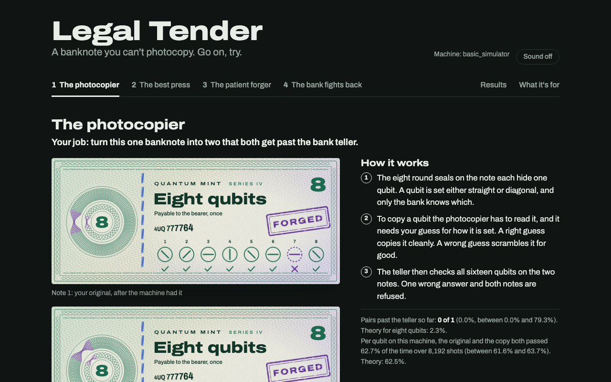

# Legal Tender

A banknote you can't photocopy. Go on, try.



Legal Tender is a forgery game with a proof inside it, built for the Qollab x IonQ hackathon, October 2026. The bank prints a note whose serial number is eight qubits. You get three ways to turn one note into two, and then you change sides and redesign the note. Every note, forgery and teller check is a Qiskit circuit. The page works out the most any forging machine could score and shows that its circuits reach it. The measurements cover seven simulators and one real IonQ Forte 1.

This effort is supported by Qollab & IonQ.

Play it on Qollab: https://qollab.xyz/u/kinnu/legal-tender

The full write-up, with results, the proof and derivations, is in [legal-tender/README.md](legal-tender/README.md). That folder is exactly what runs on Qollab.

## What is in this repository

| Path | What it is |
|---|---|
| `legal-tender/` | The Qollab project: page, styles, Python package, licence and write-up |
| `is-it-quantum/` | A second, smaller project: tell a real quantum machine from three fakers with the cross-entropy test |
| `tests/` | 152 tests. 123 check Legal Tender's circuits, limits and proof against exact theory, and 29 check the second project's score, fakers and fit |
| `dev/` | A local preview that stands in for Qollab's browser runtime |
| `tools/` | Packaging, the results-table builder, the heist statistics and the cover picture script |
| `evidence/` | One saved run per machine, the source of the results tables. Version 1 runs are in `evidence/v1` |

## Run it locally

Python 3.14 and Qiskit 2.5, to match Qollab's runtime.

```bash
uv venv --python 3.14 .venv
uv pip install --python .venv/bin/python "qiskit>=2.5.2,<3.0.0" pytest
.venv/bin/python dev/serve.py
```

Then open http://127.0.0.1:8791. Add `?fallback=1` to exercise the path where the page runs the job itself, and start the server with `KIND=remote` to preview the one-job mode IonQ backends get.

```bash
.venv/bin/python -m pytest tests -q
```

The proof on its own, without the game:

```bash
cd legal-tender && ../.venv/bin/python -c "from legaltender import proof; [print(c['note'], c['teller'], c['limit'], c['reached']) for c in proof.certificates()]"
```

To rebuild the results tables from the saved runs:

```bash
.venv/bin/python tools/ledger.py --check
```

## Licence

MIT. See [LICENSE](LICENSE).
